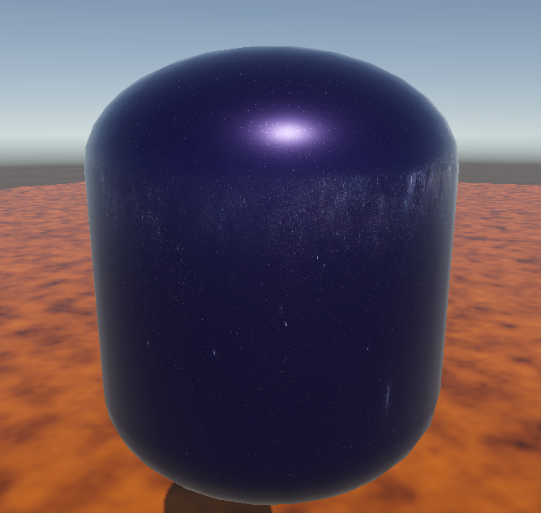
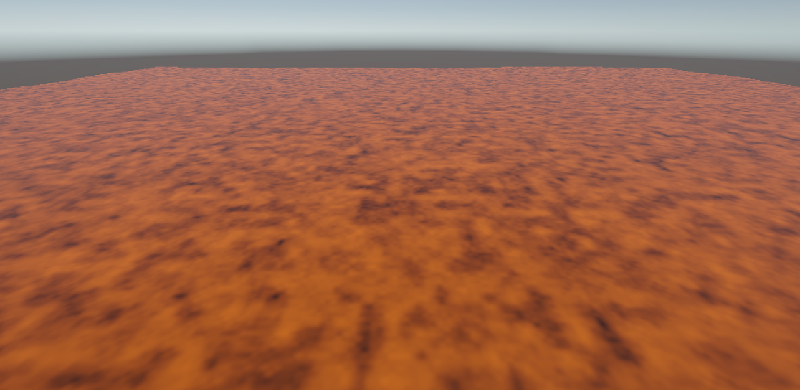
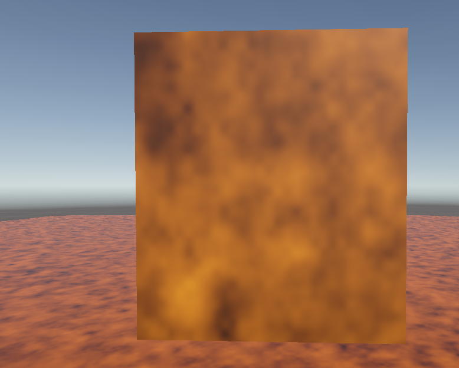
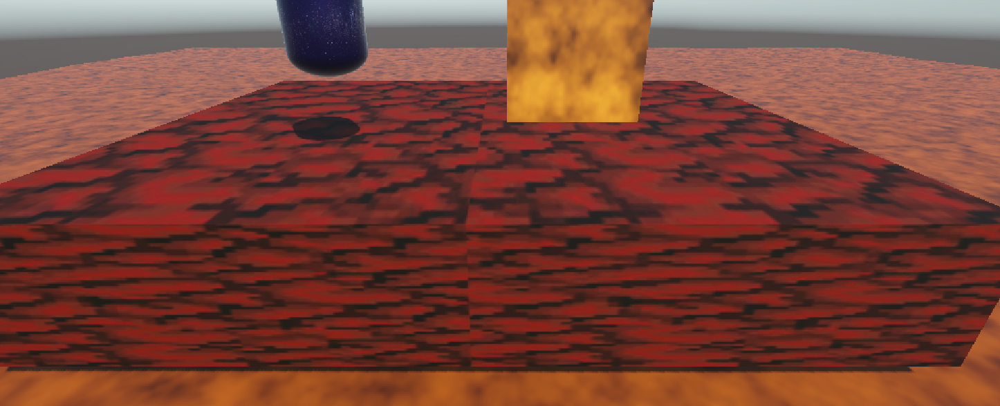
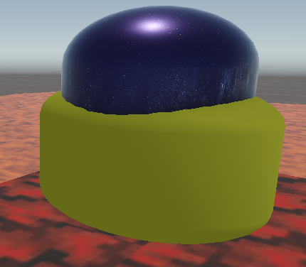
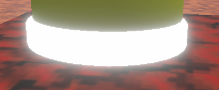

# Make-up Midterm Assignment

## Reflection Shader

This shader allows an object to reflect a cubemap, and unlike the one in class, it also has adjustable metallic and roughness properties. This allows the reflecting object to appear even more like a shiny, reflective surface. This shader is great for the reflective armour that the battletoads wear, and the color changing property is perfect as well, since it will allow each player to have a different armor color when playing local co-op. The lighting from the lit shadergraph improves the look of this shader greatly.

## Tiling Shader

This lava shader has a scrolling noise texture, and also has a vertical vertex offset based on the noise texture. The scrolling noise offsets create an effect that makes the lava look like it's flowing and waving, just like in the game battletoads. The noise texture also looks a lot like the surface of lava, especially when it's multiplied by an orange color. Combined, these turn a simple plane into something that looks like real lava.

## Multiple UVs shader

This shader combines two noise textures that are sampled with two sets of scrolling UVs with different time scales. Not only is each noise texture at a different time scale, but they're also sampled at different noise scales, creating even more depth in this layered effect. The depth that this gives makes the shader appear much more like a real flickering flame.

## General textures

This versatile texture application shader is great for general use. It has many adjustable fields such as metallic, smoothness, color, and tiling scale and offset. These allow it to be applied to many different objects, meeting each of their needs to replicate different materials. The easily adjustable tiling is great for making sure that the texture is scaled properly for different sized objects, such as the differently sized islands in battletoads.

## Changing lighting model

This shader alternates between simple diffuse and wrap diffuse. For this demonstration, I have tweened the wrap coefficient so you can see the change easily. This is a perfect choice for this game, because different environments that the player enters will need different diffuse lighting. When in a fiery environment with lots of light coming from different angles, a high wrap coefficient is a great choice to show all that extra light wrapping around objects or players. When in an environment with light from only one direction, disabling diffuse wrapping fits the game better.

## My choice

My shader of choice is one that pulses the emmission property of a material over time. This pulsing light effect is perfect for the glowing lights on the hoverboard that the battletoads stand on, and it makes the machine they ride appear even more technologically advanced. I also made it pulse using Sine Time, which eases the property in and out, because it creates a satisfying and smooth pulse that doesn't cause flickering.